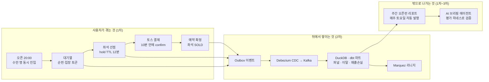
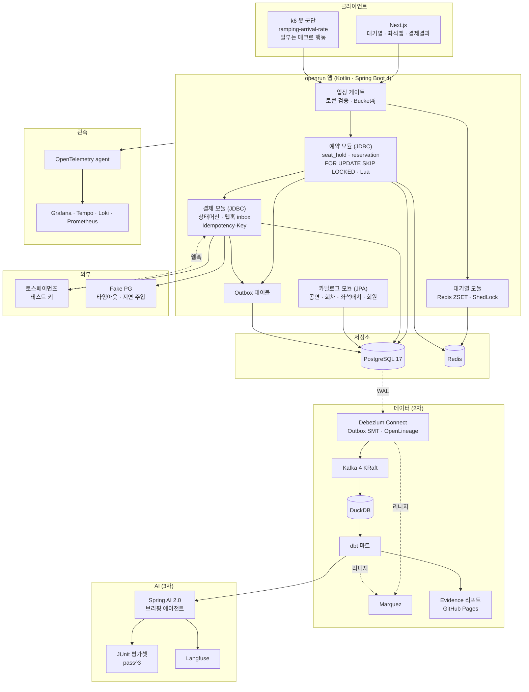
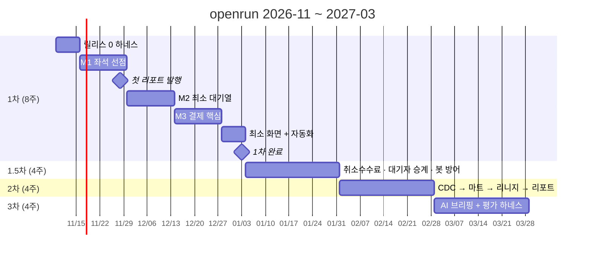
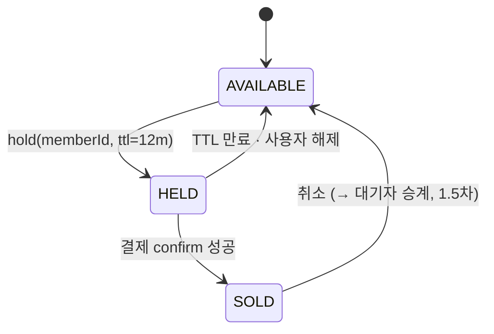
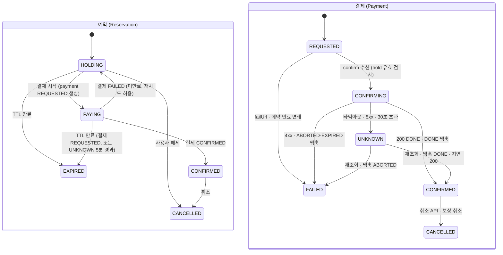
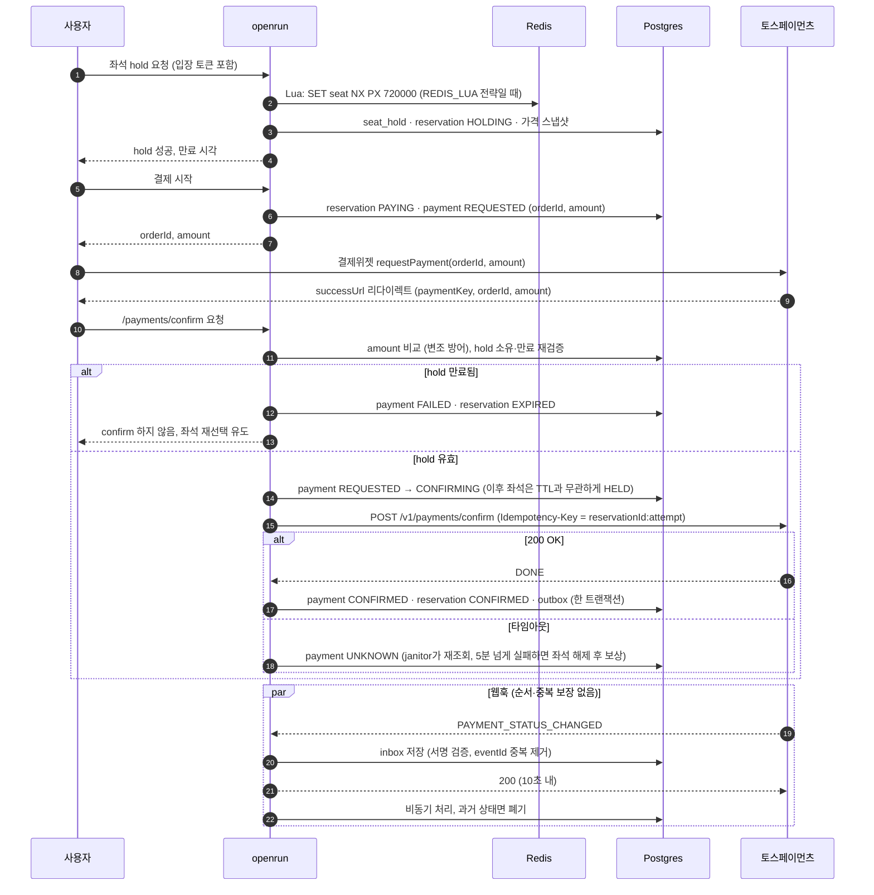
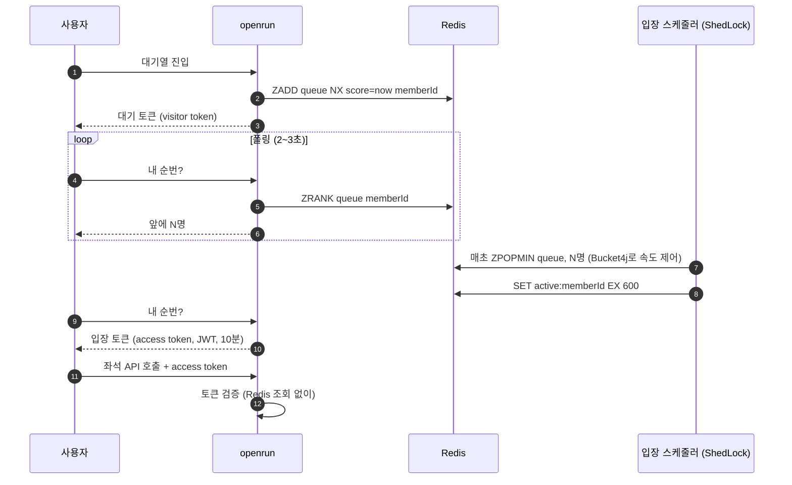
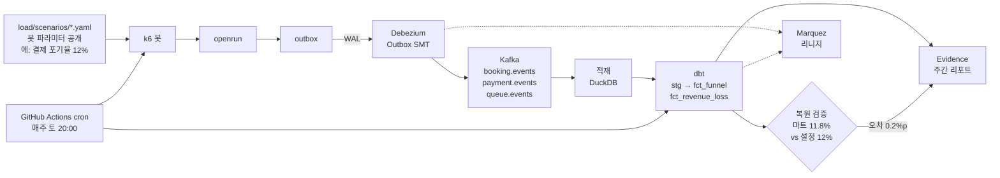
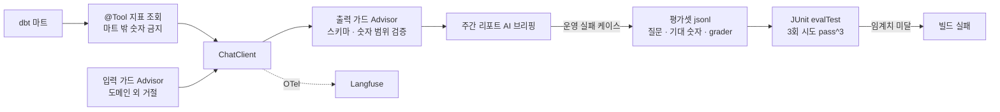
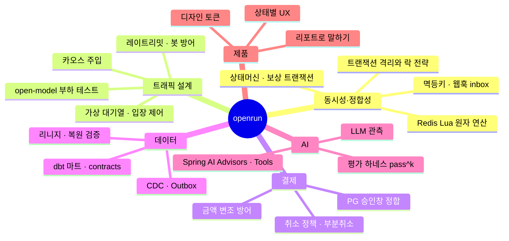

# openrun 블루프린트: 무엇을 만들고, 무엇을 익히고, 무엇이 남는가

최종 수정: 2026-11-10. 세부 일정과 결정 근거는 [roadmap.md](roadmap.md)와 [adr/](adr/)에 있다. 이 문서는 전체 그림을 한 장에 보기 위한 것이다.

---

## 1. 제품 흐름 한눈에 보기

사용자가 겪는 흐름과, 그 뒤에서 쌓이는 데이터, 그리고 리포트까지 하나의 선으로 이어진다.



---

## 2. 시스템 아키텍처



---

## 3. 릴리스 타임라인



---

## 4. 단계별: 만드는 것 · 익히는 것 · 쓰는 것 · 남는 것

| 단계 | 만드는 기능 | 익히는 스킬 | 쓰는 오픈소스 · 레퍼런스 | 시연 가능한 결과물 |
|---|---|---|---|---|
| **릴리스 0** 하네스 | Gradle 멀티모듈 골격, compose `core`, CI, 리포트 템플릿, 요구사항 v1 | Spring Boot 4 마이그레이션 감각, Testcontainers, ArchUnit 경계 테스트, ADR 쓰기 | Testcontainers, ArchUnit, Flyway, k6, Docker Compose profiles | 빌드·테스트·부하 스모크가 도는 빈 서비스. ADR 3개 |
| **M1** 좌석 선점 | 좌석 hold API, 만료 스케줄러, 락 전략 5종 비교, Inventory 추상화(지정석) | 트랜잭션 격리 수준, `FOR UPDATE` vs `SKIP LOCKED` vs 조건부 UPDATE, Redis Lua 원자성, open-model 부하 설계 | alf.io `TicketRepository`(설계만), pretix `locking.py`(설계만), Spring Data Redis `DefaultRedisScript`, ShedLock, k6 `ramping-arrival-rate`, Tecoble 락 비교 글, 올리브영 선착순 쿠폰 글 | **리포트 #1**: 오버셀 N건 → 0건, 전략별 p99·처리량 비교표 |
| **M2** 최소 대기열 | 순번 발급, 폴링 API, 입장 스케줄러, 입장 토큰(JWT), 좌석 API 토큰 검증, 입장 속도 제어 | 분산 카운터, FIFO 공정성 측정, 토큰 기반 접근 제어, 레이트리밋 | Redis ZSET, Bucket4j, ShedLock, SeatGeek "Room" 발표, Cloudflare Waiting Room 글, AWS 대기열 코드(설계만) | 리포트에 대기열 이탈률·FIFO 위반률 추가. "새로고침 폭풍" 시나리오 통과 |
| **M3** 결제 핵심 | 토스 결제위젯 연동, confirm, 서버 금액 검증, 멱등키, 웹훅 inbox, 예약·결제 상태머신 분리, Fake PG | PG 승인창과 내부 TTL 정합, 웹훅 멱등·순서 역행 처리, sealed class 상태머신, 결과형 타입(Success·Failure·Unknown) | 토스페이먼츠 문서 + tosspayments-sample, Medusa `completeCartWorkflow`, Saleor TransactionItem, Temporal `bookingsaga`(설계만), Arrow `saga`, Resilience4j, 카카오페이 msa-transaction 글 | 리포트에 hold→confirm 전환율, 승인·만료 레이스 0건. 실제 토스 테스트 결제 영상 |
| **M4** 화면 + 자동화 | Next.js 3페이지, 주간 오픈런 cron, 리포트 자동 발행, README | 상태별 UX(대기·만료·실패), 최소 디자인 토큰, GitHub Actions 스케줄 | Next.js, SVG 좌석맵 직접 구현, SEED 토큰 구조(참고), GitHub Actions | **1차 완료**: 공개 데모 URL + 매주 자동 발행되는 리포트 페이지 |
| **1.5차** 제품 완성도 | 취소수수료 정책 엔진, 부분취소, 대기자 승계(hold 체인), janitor 확장, 봇 방어, 사람 참여 오픈런 데이 | 정책 테이블 설계, 보상 트랜잭션, 어뷰징 대응, 사람 vs 봇 공정성 측정 | Stripe limited inventory 문서, commercetools ReserveOnCart 문서, Turnstile 또는 ALTCHA, fingerprintjs, 우아한형제들 결제 장애 대응 글 | 리포트에 취소 정확도·봇 차단률·사람 vs 봇 성공률 추가 |
| **2차** 측정 파이프라인 | Outbox CDC, Kafka 토픽, DuckDB 적재, dbt 마트(퍼널·이탈·매출손실), 복원 검증, 리니지, Evidence 리포트 | CDC 운영, 이벤트 스키마, 세션 윈도우 퍼널, dbt contracts·tests, OpenLineage, 데이터 품질 자동점검 | Debezium(Outbox SMT + OpenLineage), Kafka 4, Apicurio, DuckDB, dbt-duckdb, Marquez, Evidence | 오픈런 리플레이 화면, 리니지 그래프, "봇 파라미터 복원 오차 0.x%p" |
| **3차** AI 브리핑 + 평가 | 리포트 브리핑 에이전트, 지표 조회 `@Tool`, 입·출력 가드 Advisor, 평가셋, 트레이싱, 실패 케이스 환류 | Spring AI Advisors, 에이전트 평가 설계(pass^k, grader 분리), LLM 관측, 운영 실패 → 평가셋 루프 | Spring AI 2.0, Langfuse, OpenTelemetry GenAI 규약, Anthropic 에이전트 평가 글, 토스 Benchmark 구축기 | 매주 리포트 상단에 AI 브리핑 + 평가 성적표(정답률·환각 0건) |

---

## 5. 핵심 설계 그림

### 5-1. 좌석 상태



좌석 상태는 예약·결제 상태에서 파생된다. 결제 진행 중(PAYING)인 좌석은 TTL이 지나도 HELD로 남는다. 규칙은 [ADR-0004](adr/0004-state-transitions.md).

### 5-2. 예약과 결제, 두 상태머신 분리 (M3)

친구 레포는 결제 단일 상태머신이다. 우리는 좌석 hold가 Stripe의 authorize 역할을 대신하므로 두 애그리거트를 분리한다.



규칙: 상태 전이는 단조(monotonic)다. 웹훅이 늦게 와서 과거 상태를 말하면 폐기한다. confirm 호출 중에는 좌석이 HELD로 유지되므로 응답이 늦어도 확정한다. 토스 조회가 5분 이상 실패해 좌석을 푼 뒤 승인이 확인되면 자동 취소로 보상한다. 전이표는 [ADR-0004](adr/0004-state-transitions.md).

### 5-3. hold TTL과 토스 10분 승인창 정합 (M3의 핵심)



### 5-4. 대기열 (M2)



측정하는 것: 이탈률(진입 후 입장 전 폴링 중단), FIFO 위반률(늦게 온 사람이 먼저 입장한 비율), 새로고침 폭풍 시 순번 유지 여부.

### 5-5. 데이터 파이프라인과 복원 검증 (2차)



### 5-6. AI 브리핑과 평가 하네스 (3차)



---

## 6. 레포 구조 (목표)

```
openrun/
├── apps/
│   ├── api/                  # Spring Boot 4 · Kotlin (모듈 조립)
│   └── web/                  # Next.js
├── modules/
│   ├── domain-catalog/       # JPA: 공연 · 회차 · 좌석배치 · 회원
│   ├── domain-booking/       # JDBC: seat_hold · reservation · 대기열
│   ├── domain-payment/       # JDBC: payment · inbox · 상태머신
│   ├── outbox/               # outbox 테이블 · relay
│   └── support/              # 공통 (ids, time, 결과형 타입)
├── load/
│   ├── scenarios/            # 봇 파라미터 yaml (공개)
│   └── k6/                   # 시나리오 스크립트
├── data/                     # 2차
│   ├── debezium/             # 커넥터 설정
│   ├── dbt/                  # 마트 모델 · tests · contracts
│   └── evidence/             # 리포트 사이트
├── ai/                       # 3차
│   ├── evals/                # 골든셋 jsonl
│   └── ...
├── infra/
│   └── compose/              # profiles: core · lake · lineage · bi · ai
├── docs/
│   ├── roadmap.md
│   ├── blueprint.md          # 이 문서
│   ├── adr/
│   ├── research/
│   └── reports/              # 주간 오픈런 리포트 아카이브
└── .github/workflows/        # ci · weekly-openrun · dbt
```

---

## 7. 최종 결과물

### 7-1. 공개되는 것

```
┌──────────────────────────────────────────────────────────────┐
│  openrun.dev (가칭) — 주간 오픈런 리포트 #14          2027-03  │
├──────────────────────────────────────────────────────────────┤
│  환경: GitHub Actions ubuntu-latest · 4 vCPU · 16GB · 3회 중앙값 │
│  데이터 출처: synthetic 92% · human 8%                        │
├────────────────┬────────────────┬────────────────┬───────────┤
│ 도착률 peak    │ 오버셀         │ p99 (hold)     │ FIFO 위반  │
│ 3,000 rps      │ 0건            │ 142 ms         │ 0.3%      │
├────────────────┼────────────────┼────────────────┼───────────┤
│ 대기열 이탈률   │ hold→confirm   │ 레이스 잔존     │ 봇 차단률  │
│ 14.8%          │ 86.1%          │ 0건            │ 94.1%     │
├────────────────┴────────────────┴────────────────┴───────────┤
│ 퍼널  진입 ████████████ 100%  (10,000명)                       │
│       입장 ██████████▏  85%                                   │
│       hold █▍           11%  (1,500석 / 평균 1.4석 ≈ 1,070건)   │
│       결제 █▎           10%                                   │
│       확정 █▏            9%  ← 미확정 좌석 추정 손실 (합성)       │
├──────────────────────────────────────────────────────────────┤
│ 복원 검증: 설정 이탈률 15.0% → 마트 14.8% (오차 0.2%p)          │
│ 리니지: outbox → kafka → stg_events → fct_funnel  [Marquez]   │
├──────────────────────────────────────────────────────────────┤
│ AI 브리핑 (평가 정답률 97%, 환각 0건)                           │
│ "이번 주 p99가 지난주 대비 23ms 개선됐습니다. 원인은 좌석맵     │
│  조회에 Caffeine L1 캐시를 적용한 PR #41 …"                    │
├──────────────────────────────────────────────────────────────┤
│ 지난 리포트 ← #13 #12 #11 …    [오픈런 리플레이 보기 ▶]         │
└──────────────────────────────────────────────────────────────┘
```

- 공개 데모 URL과 주간 리포트 아카이브 (GitHub Pages)
- 레포: 단계별 README, ADR, 문제 재현 테스트, 참고 문헌 표(라이선스 명시)
- 블로그 시리즈 8편 (단계마다 한 편: 숫자와 트레이드오프 중심)

### 7-2. 직군별로 말할 수 있는 것

| 직군 | 1분 설명 | 근거가 되는 산출물 |
|---|---|---|
| 백엔드·프로덕트 | "오픈 순간 3,000 rps를 오버셀 0건으로 받아내고, 좌석 hold와 PG 승인창의 레이스를 상태머신 분리로 해결했으며, 매주 리포트 숫자로 개선을 증명했습니다." | M1~M3 리포트, ADR-0003, 상태머신 코드, 토스 실연동 |
| 데이터 (관심 영역) | "CDC로 이벤트를 모아 퍼널 마트를 만들고, 봇 파라미터 복원 오차로 파이프라인 정확성을 검증했으며, 리니지가 자동으로 그려집니다." | 2차 리포트, dbt tests·contracts, Marquez 그래프, ADR-0002 |
| AI (관심 영역) | "에이전트는 마트 지표만 인용하고, 평가셋을 3회 통과해야 배포되며, 운영 실패는 평가셋으로 환류됩니다." | 3차 평가 성적표, evals jsonl, Langfuse 트레이스 |

### 7-3. 이 프로젝트가 익히게 하는 스킬 맵


